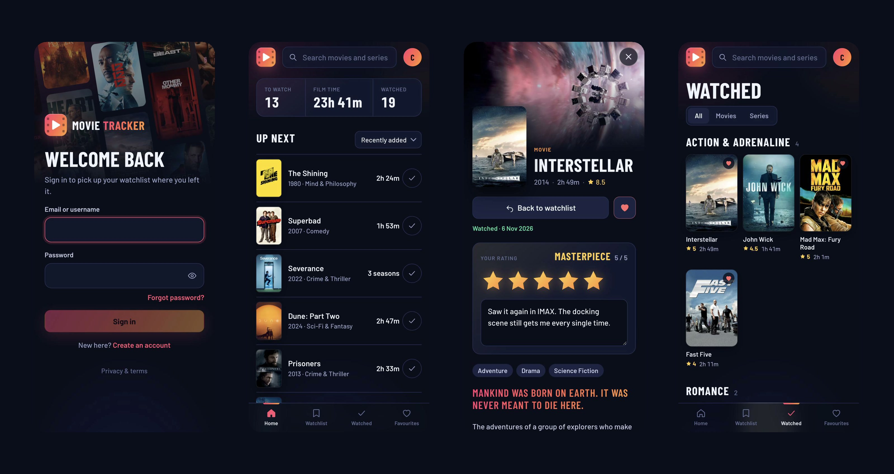

# Movie Tracker

**Movie Tracker** is a web app for keeping track of the movies and TV series you want to watch and the ones you already watched. You can **search** any title, read its details and **cast**, save it to your **watchlist**, mark it **watched**, give it your own **star rating** with notes and add it to **favourites**. Everything is sorted onto **shelves** by category, and every user has their own **account**. It works on phone and desktop.

🔗 **Live:** https://movie-tracker.movietrackerr.workers.dev

<p align="center">
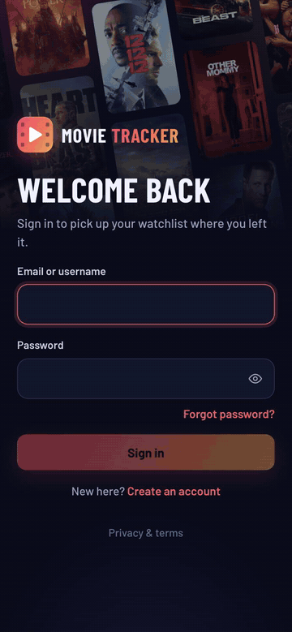
</p>

## ⛓ Features

- When the app is opened, user should **sign in** or **create an account**. There are two ways: **email, username and password**, or **Sign in with Google**. While typing a password, **password rules** turn green with a tick or red with a cross, and the app checks live if the **username is available**. A **confirmation link** is sent to the email, and there is a "**Forgot password?**" option which sends a reset link.

<p align="center">
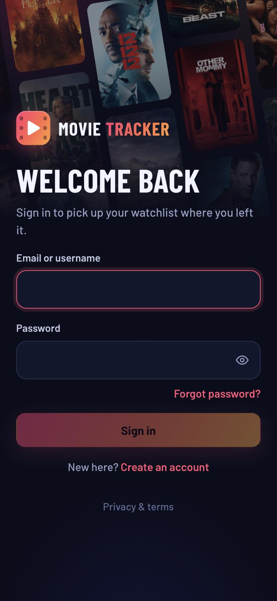
&nbsp; &nbsp; &nbsp; &nbsp; &nbsp; &nbsp;
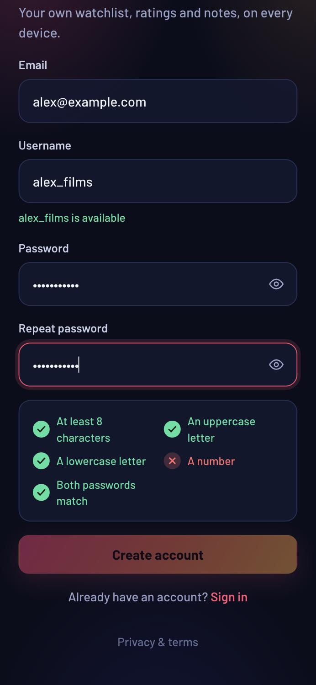
</p>

- After signing in, **home screen** shows what is **up next** with poster, name and duration (like "2h 24m" or "3 seasons"), plus how many titles are waiting and how much **film time** that is. Tapping the tick marks a title as **watched**. **Search bar** on top finds any movie or series from **TMDB**.

<p align="center">
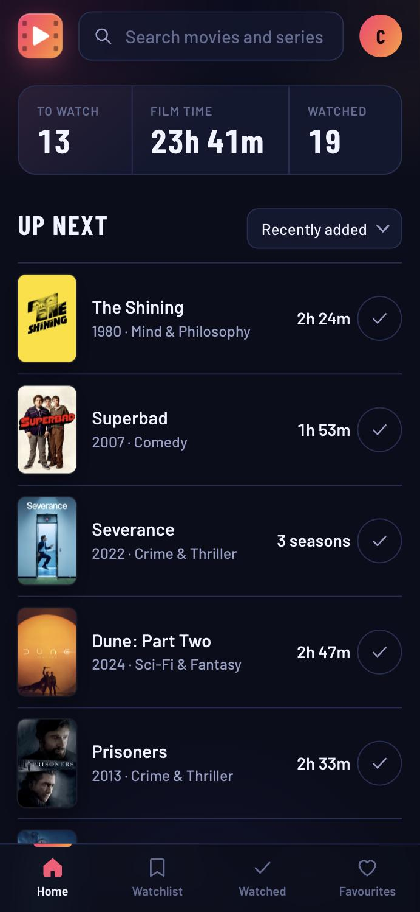
&nbsp; &nbsp; &nbsp; &nbsp; &nbsp; &nbsp;
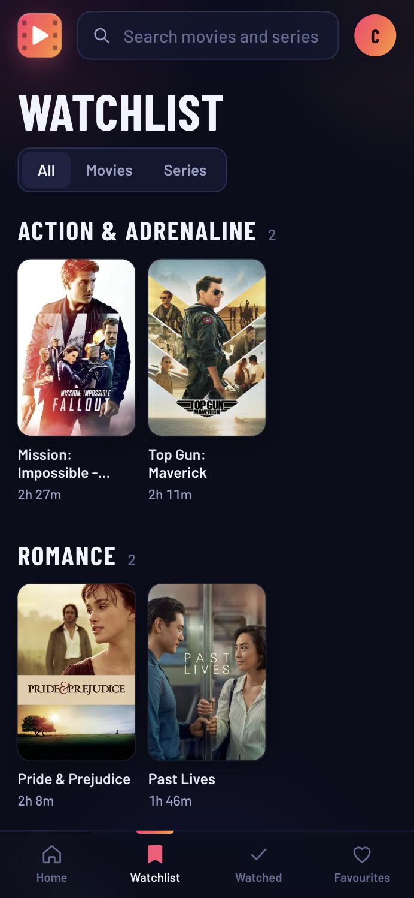
</p>

- **Watchlist** and **Watched** are grouped into **shelves**: Action & Adrenaline, Romance, War, Mind & Philosophy, Crime & Thriller, Sci-Fi & Fantasy and more. The shelf is picked **automatically** from genres and keywords of the title, and user can **move** a title to another shelf. Lists can be filtered by **movies** or **series**.

- Tapping a title opens its **detail sheet** with year, duration, TMDB score, overview, director, **trailer** link and **cast**. For watched titles user can give **their own rating** in half-star steps (by tapping or sliding) and write **notes**, which are saved automatically.

<p align="center">
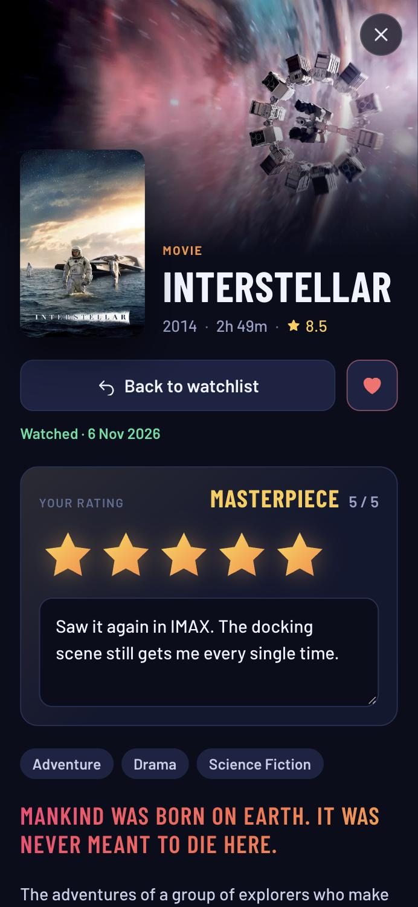
&nbsp; &nbsp; &nbsp; &nbsp; &nbsp; &nbsp;
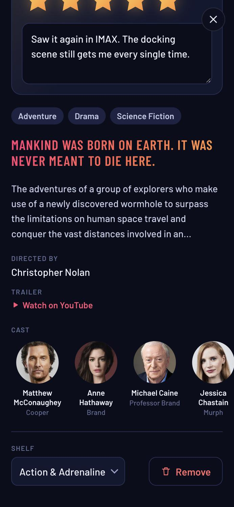
</p>

- **Profile** shows stats (watched count, film time, average rating, favourites) and account settings: **change username**, **change password**, **sign out**, **sign out everywhere** and **delete account**. There is also **Import a list**, where a list of titles pasted from notes is added all at once.

<p align="center">
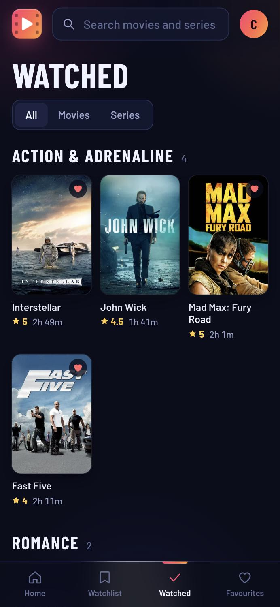
&nbsp; &nbsp; &nbsp; &nbsp; &nbsp; &nbsp;
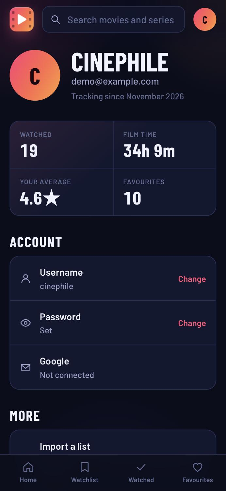
</p>

## Desktop

The same app on a wide screen, with a sidebar instead of the bottom tab bar.

<p align="center">
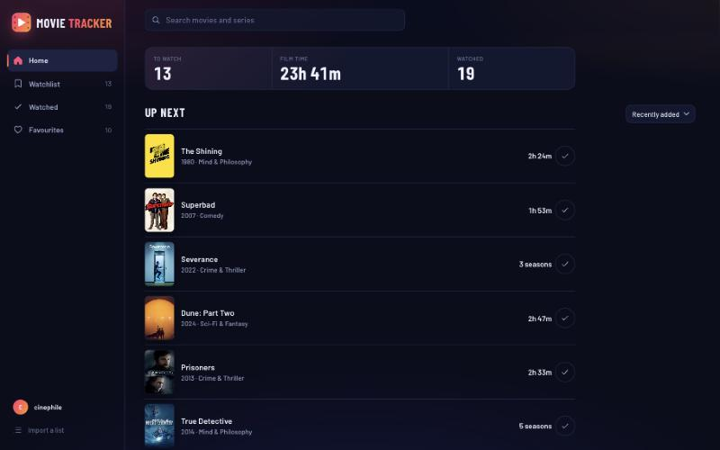
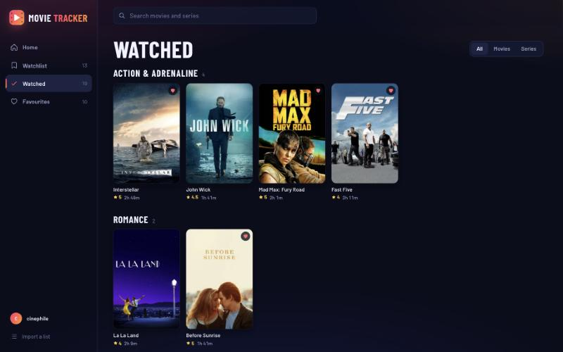
</p>

## Security

- Passwords are stored only as **salted PBKDF2-SHA256 hashes** (100,000 iterations).
- Session, email confirmation and password reset tokens are stored only as **hashes**. Session lives in an **HttpOnly cookie**, slides for 30 days and always ends after 180 days. Resetting a password **ends all sessions**.
- **Rate limits**: 300 requests per minute per visitor on the API, and 10 per minute on sign-in, sign-up and reset.
- **TMDB key** stays on the server, it never reaches the browser.

## Technical Background

| Technology | Used for |
| --- | --- |
| **React 19** | All screens and components of the app (home, shelves, detail sheet, sign-in, profile). |
| **TypeScript** | The whole codebase, frontend and backend, with shared types for titles and users. |
| **Vite** | Dev server and production build of the frontend. |
| **Plain CSS** | All styling, with colours and fonts kept as CSS variables. No UI library is used. |
| **Cloudflare Workers** | Backend. One Worker handles every `/api/*` request and also serves the built website. |
| **Cloudflare D1 (SQLite)** | Database for users, sessions, email tokens and each user's saved titles, ratings and notes. |
| **Cloudflare Rate Limiting** | Limits requests per visitor to protect the API and the sign-in endpoints. |
| **Wrangler** | Running the Worker and database locally, storing secrets and deploying. |
| **TMDB API** | Search, title details, cast, trailers, posters and weekly trending. Called only from the Worker. |
| **Web Crypto API** | Password hashing (PBKDF2-SHA256), random tokens and token hashing inside the Worker. |
| **Google OAuth 2.0** | "Continue with Google" sign-in. |
| **Brevo** | Sending the email confirmation and password reset emails. |
| **View Transitions API** | Poster animation between a list and its detail sheet. |
| **History API** | Small hash router written by hand, so the back button and back gesture close a detail sheet. |
| **localStorage** | Cached copy of the user's list, so the app opens instantly before the server answers. |
| **Google Fonts** | Barlow and Barlow Condensed typefaces. |

- Saving is **optimistic**: the screen updates immediately, then the change is sent to the server, and it is rolled back with a message if the request fails.
- The app is **mobile first** and respects **reduced motion** settings.
- Everything runs on **free tiers**.

## Running Locally

1. Install packages:

```bash
npm install
```

2. Create a file named `.dev.vars` in the project folder and put your TMDB key in it (v3 key or v4 read token, both work). There is an example in `.dev.vars.example`.

3. Start the app:

```bash
npm run dev
```

Then open http://localhost:5173. Locally no email service is needed: the confirmation link is shown on screen after sign-up.

For deploying to your own Cloudflare account, create a D1 database, put its id into `wrangler.jsonc`, add the secrets (`TMDB_KEY`, and optionally `BREVO_API_KEY`, `MAIL_FROM`, `GOOGLE_CLIENT_ID`, `GOOGLE_CLIENT_SECRET`) with `npx wrangler secret put`, then run `npm run deploy`.

---

This product uses the TMDB API but is not endorsed or certified by TMDB.
